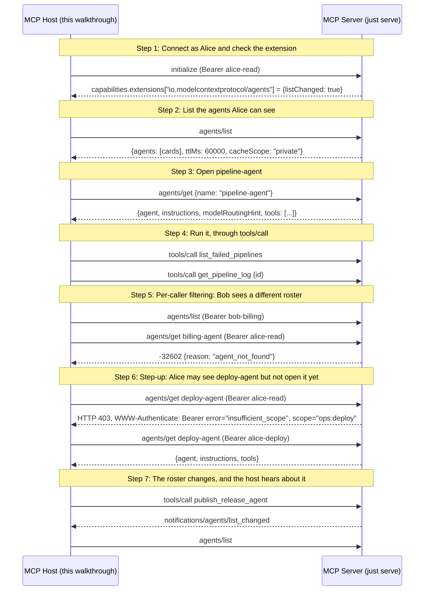

# MCP agents: discovery, scoping, per-caller filtering and step-up

Walks through the agent discovery extension (agents-wg#22, implemented in `experimental/ext/agents`). A server advertises agents, each a named group of its own tools with instructions. A host lists them with `agents/list`, opens one with `agents/get`, and runs it locally, calling the scoped tools through the ordinary `tools/call`. Three callers with different scopes show what each one is allowed to see and open.

## What you'll learn

- **Connect as Alice and check the extension** - A host must not assume agent discovery unless the server advertises it. `listChanged: true` says the server will announce roster changes.
- **List the agents Alice can see** - The roster carries routing fields only, never instructions or tool schemas, so a large roster stays cheap. `billing-agent` is missing because Alice lacks `billing:read`. `cacheScope` is `private` because the answer depends on who asks.
- **Open pipeline-agent** - `agents/get` returns the instructions, an advisory model hint and the full schemas of the agent's tools. Every tool it returns also appears in `tools/list`, field for field. The host maps the hint onto its own models with `agentsclient.RoleTable`.
- **Run it, through tools/call** - There is no agent-invocation method. The host runs the agent locally with its own model and calls the scoped tools like any other tool. This step stands in for the model and calls each one once.
- **Per-caller filtering: Bob sees a different roster** - Bob holds `billing:read`, so his roster includes `billing-agent`. When Alice asks for it by name she gets `agent_not_found`, exactly what a name that was never registered returns, so she cannot probe for agents she is not meant to know about.
- **Step-up: Alice may see deploy-agent but not open it yet** - `deploy-agent` is in Alice's roster, so she is allowed to know it exists, but `agents/get` asks for `ops:deploy`. The server answers with the standard step-up challenge, `agentsclient.StepUpScopes` reads the scopes out of it, and the host retries with a broader token for the same user. The refusal is never cached, so the retry reaches the server.
- **The roster changes, and the host hears about it** - The roster was cached for its 60 s `ttlMs`, so only the notification can make the host see `release-agent` sooner. On the session wire it arrives on the GET stream; on the stateless wire `agentsclient.WatchListChanged` opens a `subscriptions/listen` stream for it. Either way the handler calls `Cache.Invalidate`.

## Flow



## Steps

### Setup

Start the server in a separate terminal first:

```
Terminal 1:  just serve         # agents server on :8080
Terminal 2:  just demo          # this walkthrough (--tui for the interactive TUI)
```

The server accepts three demo bearer tokens in place of an authorization server: `alice-read` (`ops:read`), `alice-deploy` (`ops:read ops:deploy`) and `bob-billing` (`ops:read billing:read`). `examples/fine-grained-auth` shows the same step-up flow against a real one.

### The roster

| Agent | Tools | Who sees it | Who can open it |
|---|---|---|---|
| `pipeline-agent` | `list_failed_pipelines`, `get_pipeline_log` | everyone | everyone |
| `billing-agent` | `list_invoices` | `billing:read` only | `billing:read` only |
| `deploy-agent` | `list_failed_pipelines`, `deploy_service` | everyone | `ops:deploy` only (step-up) |

### Step 1: Connect as Alice and check the extension

A host must not assume agent discovery unless the server advertises it. `listChanged: true` says the server will announce roster changes.

### Step 2: List the agents Alice can see

The roster carries routing fields only, never instructions or tool schemas, so a large roster stays cheap. `billing-agent` is missing because Alice lacks `billing:read`. `cacheScope` is `private` because the answer depends on who asks.

### Step 3: Open pipeline-agent

`agents/get` returns the instructions, an advisory model hint and the full schemas of the agent's tools. Every tool it returns also appears in `tools/list`, field for field. The host maps the hint onto its own models with `agentsclient.RoleTable`.

### Step 4: Run it, through tools/call

There is no agent-invocation method. The host runs the agent locally with its own model and calls the scoped tools like any other tool. This step stands in for the model and calls each one once.

### Step 5: Per-caller filtering: Bob sees a different roster

Bob holds `billing:read`, so his roster includes `billing-agent`. When Alice asks for it by name she gets `agent_not_found`, exactly what a name that was never registered returns, so she cannot probe for agents she is not meant to know about.

### Step 6: Step-up: Alice may see deploy-agent but not open it yet

`deploy-agent` is in Alice's roster, so she is allowed to know it exists, but `agents/get` asks for `ops:deploy`. The server answers with the standard step-up challenge, `agentsclient.StepUpScopes` reads the scopes out of it, and the host retries with a broader token for the same user. The refusal is never cached, so the retry reaches the server.

### Step 7: The roster changes, and the host hears about it

The roster was cached for its 60 s `ttlMs`, so only the notification can make the host see `release-agent` sooner. On the session wire it arrives on the GET stream; on the stateless wire `agentsclient.WatchListChanged` opens a `subscriptions/listen` stream for it. Either way the handler calls `Cache.Invalidate`.

### Where to look in the code

- Server: `agents.Register`, `AgentDef` (including `ScopeChallenge`) and `Config.Visible`, in `experimental/ext/agents/`
- Host helpers: `agentsclient.Cache`, `WatchListChanged`, `RoleTable`, `StepUpScopes`, in `experimental/ext/agents/clients/go/`
- This example's host: `host.go`. Its server: `buildServer` in `main.go`
- Spec: https://github.com/modelcontextprotocol/agents-wg/pull/22

## Run it

```bash
go run ./examples/agents/discovery/
```

Pass `--non-interactive` to skip pauses:

```bash
go run ./examples/agents/discovery/ --non-interactive
```
