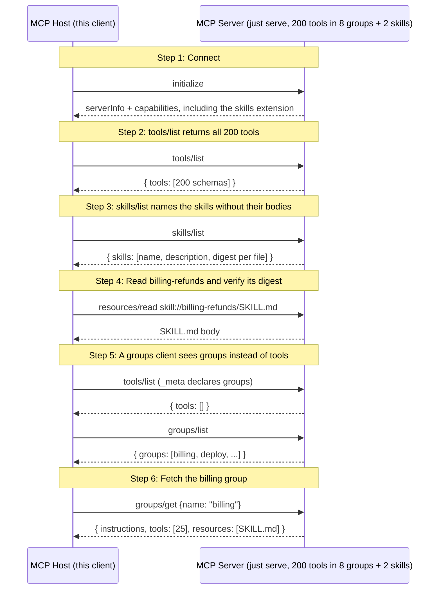

# Progressive disclosure: 200 tools, eight groups and two skills

A server with 200 tools sends all 200 in `tools/list`, and a client puts every schema into the model's context. This walkthrough counts those bytes on a fixture server and loads a skill. Then it connects a second client that declares the experimental groups extension. That client sees eight groups instead of 200 tools, and it fetches one group's tools and skill when the model picks it.

## What you'll learn

- **tools/list returns all 200 tools** - The tools come in eight themes: billing, deploy, search, users, storage, metrics, alerts and docs. A model that needs one billing tool still receives all 200 schemas. The host sends that many bytes to the model before the model does anything.
- **skills/list names the skills without their bodies** - A skill is a `SKILL.md` with instructions, served under `skill://`. The listing carries each skill's name, description and file digests. The host reads a body only when the model picks that skill.
- **Read billing-refunds and verify its digest** - `ReadFromEntry` checks the served bytes against the size and digest from the listing before the host uses them. The skill names the billing tools it needs, but it can't carry their schemas. Groups deliver those.
- **A groups client sees groups instead of tools** - Every tool on this server sits in a group, so the groups client's `tools/list` comes back empty. `groups/list` carries a name and a one-line description per group, which is what the model picks from.
- **Fetch the billing group** - The model picked billing, so the host fetches it. The result carries 25 complete tool definitions, the group's instructions, and the skill's URI in `resources`. The host still verifies the skill through the skills extension, as in the step above.

## Flow



## Steps

### Setup

Start the server in a separate terminal first:

```
Terminal 1:  just serve         # 200 tools in 8 groups + 2 skills on :8080
Terminal 2:  just demo          # this walkthrough (--tui for the interactive TUI)
```

Both sides take `--wire=legacy` or `--wire=stateless`. The results are the same on either wire.

### Step 1: Connect

### Step 2: tools/list returns all 200 tools

The tools come in eight themes: billing, deploy, search, users, storage, metrics, alerts and docs. A model that needs one billing tool still receives all 200 schemas. The host sends that many bytes to the model before the model does anything.

### Step 3: skills/list names the skills without their bodies

A skill is a `SKILL.md` with instructions, served under `skill://`. The listing carries each skill's name, description and file digests. The host reads a body only when the model picks that skill.

### Step 4: Read billing-refunds and verify its digest

`ReadFromEntry` checks the served bytes against the size and digest from the listing before the host uses them. The skill names the billing tools it needs, but it can't carry their schemas. Groups deliver those.

### Groups (experimental)

The Progressive Disclosure working group drafts a groups extension, `io.modelcontextprotocol/groups`. The draft has no sponsor yet, and mcpkit serves it from `experimental/ext/groups`. This server puts each theme's 25 tools in a group named after the theme. The billing group also lists the billing-refunds skill.

A client opts in by declaring the extension, with `groups.ClientOption()`. The plain client above declared nothing, so it keeps the flat list.

### Step 5: A groups client sees groups instead of tools

Every tool on this server sits in a group, so the groups client's `tools/list` comes back empty. `groups/list` carries a name and a one-line description per group, which is what the model picks from.

### Step 6: Fetch the billing group

The model picked billing, so the host fetches it. The result carries 25 complete tool definitions, the group's instructions, and the skill's URI in `resources`. The host still verifies the skill through the skills extension, as in the step above.

### Where to look in the code

- The fixture: `fixture.go` in this directory
- Skills provider and client: `ext/skills/provider.go`, `ext/skills/client_methods.go`
- Groups catalog, list filter and client: `experimental/ext/groups/catalog.go`, `experimental/ext/groups/client.go`
- The seam that lets an extension hide primitives per caller: `server/list_scope.go`
- The checks `make exercise-disclosure` runs: `check.go` in this directory

## Run it

```bash
go run ./examples/disclosure/
```

Pass `--non-interactive` to skip pauses:

```bash
go run ./examples/disclosure/ --non-interactive
```
