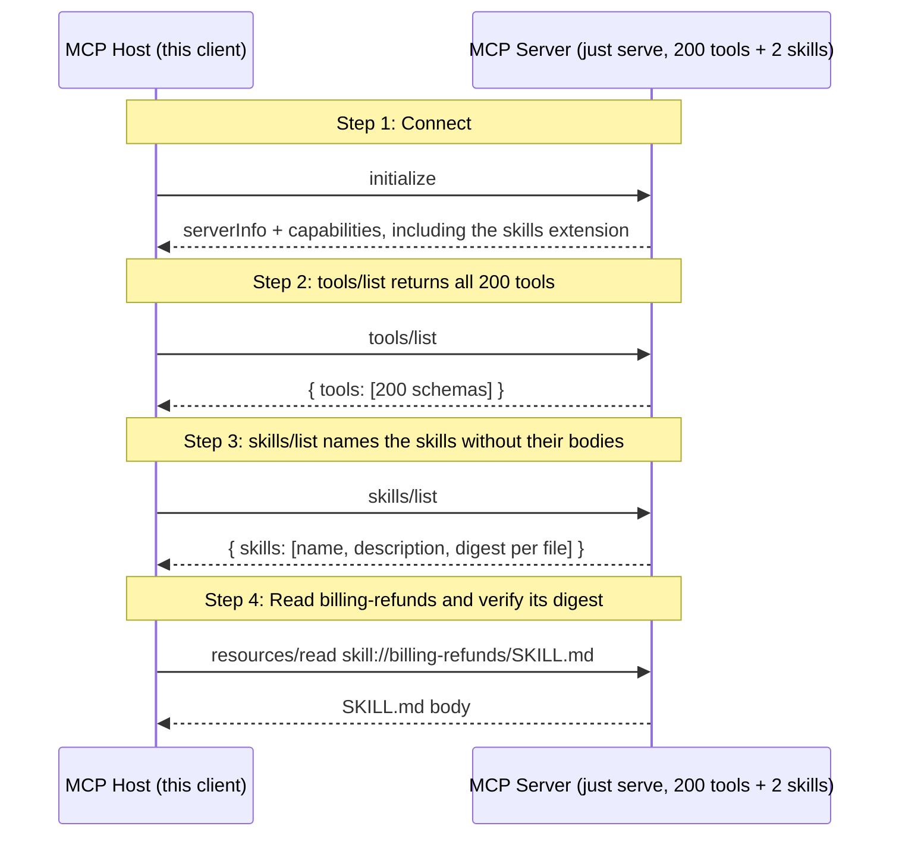

# Progressive disclosure: 200 tools and two skills

A server with 200 tools sends all 200 in `tools/list`, and a client puts every schema into the model's context. This walkthrough measures that cost on a fixture server, then loads a skill, which a client reads only when the model needs it.

## What you'll learn

- **tools/list returns all 200 tools** - The tools come in eight themes: billing, deploy, search, users, storage, metrics, alerts and docs. A model that needs one billing tool still receives all 200 schemas. The host sends that many bytes to the model before the model does anything.
- **skills/list names the skills without their bodies** - A skill is a `SKILL.md` with instructions, served under `skill://`. The listing carries each skill's name, description and file digests. The host reads a body only when the model picks that skill.
- **Read billing-refunds and verify its digest** - `ReadFromEntry` checks the served bytes against the size and digest from the listing before the host uses them. The skill names the billing tools it needs. A groups-aware server makes that link explicit.

## Flow



## Steps

### Setup

Start the server in a separate terminal first:

```
Terminal 1:  just serve         # 200 tools + 2 skills on :8080
Terminal 2:  just demo          # this walkthrough (--tui for the interactive TUI)
```

Both sides take `--wire=legacy` or `--wire=stateless`. The results are the same on either wire.

### Step 1: Connect

### Step 2: tools/list returns all 200 tools

The tools come in eight themes: billing, deploy, search, users, storage, metrics, alerts and docs. A model that needs one billing tool still receives all 200 schemas. The host sends that many bytes to the model before the model does anything.

### Step 3: skills/list names the skills without their bodies

A skill is a `SKILL.md` with instructions, served under `skill://`. The listing carries each skill's name, description and file digests. The host reads a body only when the model picks that skill.

### Step 4: Read billing-refunds and verify its digest

`ReadFromEntry` checks the served bytes against the size and digest from the listing before the host uses them. The skill names the billing tools it needs. A groups-aware server makes that link explicit.

### Where groups fit

The Progressive Disclosure working group drafts a groups extension, `io.modelcontextprotocol/groups`. A server that serves it shows one name and description per theme in `groups/list`. The client calls `groups/get` when the model picks a theme, and only then sees that theme's tools and skills. mcpkit does not serve groups yet. A groups server would need themes and skill links, and this fixture already has both.

### Where to look in the code

- The fixture: `fixture.go` in this directory
- Skills provider and client: `ext/skills/provider.go`, `ext/skills/client_methods.go`
- The checks `make exercise-disclosure` runs: `check.go` in this directory

## Run it

```bash
go run ./examples/disclosure/
```

Pass `--non-interactive` to skip pauses:

```bash
go run ./examples/disclosure/ --non-interactive
```
