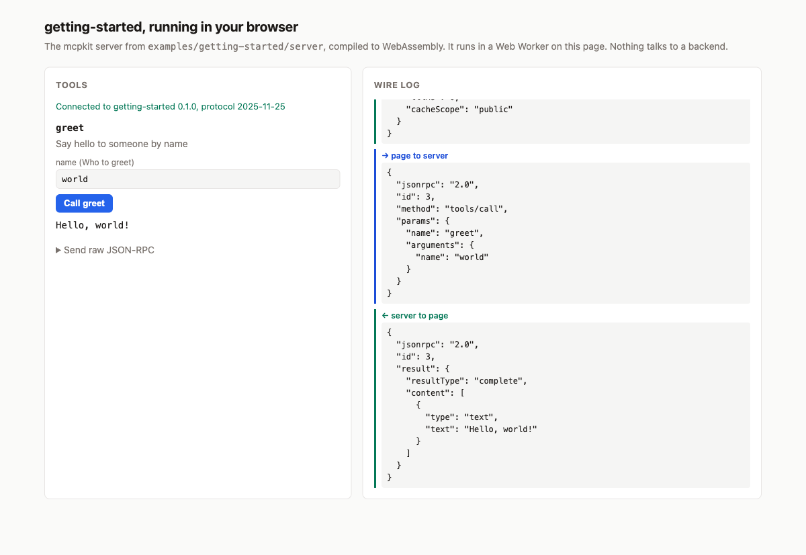

# Getting Started

The smallest useful mcpkit program: a server that exposes one typed tool, and a
client that calls it. This is the code the [Get Started
guide](https://panyam.github.io/mcpkit/get-started/) walks through, kept minimal
on purpose — its only dependency is `github.com/panyam/mcpkit`.

Unlike the other examples, this one is **not** a demokit walkthrough. It is two
tiny `main` programs you run in two terminals, so a newcomer sees exactly what
they would write in their own project.

## Quick Start

```bash
# terminal 1 — the server
just server

# terminal 2 — the client
just client
# → Hello, world!
```

## Run it in your browser

```bash
just serve-web   # or: make serve-web
# open http://localhost:8788/
```

This compiles `server/` to WebAssembly and runs it in a Web Worker on the page,
with no backend. The page lists the server's tools and calls them, and it shows
the raw JSON-RPC going each way. In a wasm build `srv.Run` serves the page over
`postMessage` instead of listening on a port, so `server/main.go` has no
browser-specific code.



## Tests

`just test` runs one scenario against `newServer()`: initialize, list the
tools, call `greet`. It runs in-process, over Streamable HTTP and over a stdio
pipe, then again under `GOOS=js GOARCH=wasm` with node. That second run covers
the browser build. It needs node on your `PATH`.

## What it demonstrates

- `server.NewServer` + `srv.Run(":8787")` — a Streamable HTTP MCP server in a
  handful of lines.
- `core.TextTool[greetInput]` — a **typed** tool. The JSON Schema is derived
  from the `greetInput` struct tags at registration time; the handler receives a
  decoded, validated struct. No `map[string]any` schema, no manual `Bind()`.
- `client.NewClient` + `c.Connect()` + `c.ToolCall("greet", …)` — connect and
  call a tool from Go, getting the text result back directly.

## Where to look in the code

- `server/main.go:greetInput` — the typed input struct that becomes the schema.
- `server/main.go:newServer` — builds the server without starting it, so the
  tests and the browser build run the same server.
- `server/main.go` `srv.Register(core.TextTool[...])` — typed registration.
- `client/main.go` `c.ToolCall("greet", …)` — the one-line client call.

## Next steps

- [Guides](https://panyam.github.io/mcpkit/guides/) — auth, tasks, apps, tracing.
- [Examples](https://panyam.github.io/mcpkit/examples/) — the full batteries-included gallery.
