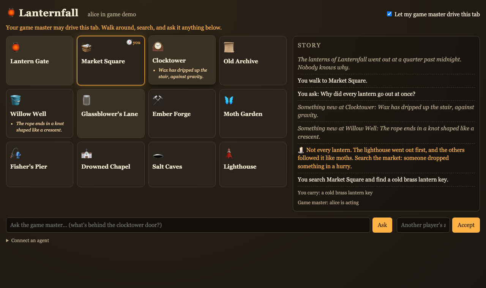
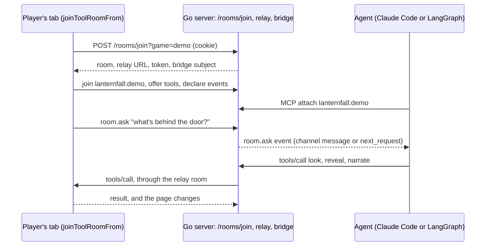

# Lanternfall: an AI game master inside your own web app

A player opens a small map game in their own browser tab. They ask a question in a box on the page.
An AI agent hears the question, looks at the player's map, writes new details onto it, hides an item
for them to find, and answers in the page's story log. The page is an ordinary web app. No chat host
renders it, and the agent can be any MCP client:

- Claude Code, whose system prompt stays as it is. It learns the game from the server's instructions
  and the page's tool descriptions.
- A custom agent on an agent SDK. [`web/src/agent/gm.ts`](web/src/agent/gm.ts) is one on LangGraph.js,
  with a game master's system prompt of its own.



The page offers the agent its tools, and tells it what the player does through declared events. A
room bridge connects the two: the page joins a relay room for its game, and the agent reaches the
page through MCP. MCP Apps covers a different case, where a host renders an app inside a chat after
a tool call. Here the user opened the page themselves, and the agent comes to it.

## Try it

```bash
go run .                                   # or: make run
```

Open <http://localhost:8080/signin?as=alice&game=demo>. Walk to a neighbouring place by clicking it.
Click where you stand to search it. Rest the pointer on a place to wonder about it. Then turn on
**Let my AI game master see and change this map** and bring in an agent.

**Claude Code**, through the `rooms-channel` front end, which turns the player's events into channel
messages. Install it from this tree, so it subscribes to the page's declared events:

```bash
(cd ../../../experimental/integrations/roomsevents && go install ./cmd/rooms-channel)
```

```json
{"mcpServers": {"rooms": {"command": "rooms-channel",
  "args": ["-bridge", "http://localhost:8080/mcp"],
  "env": {"ROOMS_BRIDGE_TOKEN": "player:alice"}}}}
```

```bash
claude --dangerously-load-development-channels server:rooms
```

Tell it "Be the game master of lanternfall:demo", then ask something in the page's box. It arrives
in Claude Code as a `room.ask` message, and the answer appears on your map.

**A LangGraph.js agent**, with `ANTHROPIC_API_KEY` set:

```bash
make gm                                    # PLAYER=alice GAME=demo by default
```

It defaults to `claude-opus-5-5` and reads `LANTERNFALL_MODEL` to use another. It reads each event
type's context hint from `events/list` and follows it, printing what it decided:

```text
[gm] context hints: item.found=high, place.examined=low, player.moved=medium
[gm] player.moved is medium priority: added to the context
[gm] item.found is high priority: reacting now
[gm] answered with lanternfall_look, lanternfall_reveal, lanternfall_narrate
[gm] compacted 13 messages (~644 tokens) into a summary
[gm] place.examined is low priority: added to the context, replacing an unseen older one
[gm] alice asks: What does the ledger page say?
```

A high-priority event gets a reaction at once, unasked. A `last-wins` aggregate keeps only the newest
event of its kind, and `session` retention keeps the latest event of its kind through compaction. A
question asked from the page is always answered. The context panel below shows all of it.

To watch events drive it, turn the switch on and walk Gate → Market → Clocktower → Old Archive, then
click the Archive to search it. The torn ledger page is high priority, so the game master narrates
without being asked. Then ask it what the page says.

**A second player.** Open <http://localhost:8080/signin?as=bob&game=demo> in another browser profile.
Bob's tab is his own map. Alice's agent cannot drive it unless Bob accepts that agent's code in the
"Another player's agent code" box.

The bearer token `player:<name>` acts for `<name>`. That is the demo's whole auth, so it is for
localhost only.

## Who decides what

Three layers, and only one of them is the model:

- **The page** is ordinary JavaScript. It draws the map, owns the twelve places and their
  descriptions, walks the player between neighbours, finds an item when the player searches where
  one is hidden, and decides when to emit an event. Each tool's handler says what that tool does to
  the screen.
- **Claude** decides everything the game master does: whether to call a tool at all, which one,
  and with what. Every orange line in the story, every italic detail on a tile, and every item
  hidden after the start come from it.
- **The harness** (`web/src/agent/gm.ts`, or Claude Code) decides what reaches Claude and when.
  The LangGraph one follows each event type's context hint: a high-priority event starts a turn,
  the rest wait in the conversation. Claude Code hands every event to Claude as a channel message.

## Watching the game master's context

The LangGraph game master keeps one conversation for the whole game, and serves it on
`http://localhost:8091/context`. The page's **Game master's context** panel shows exactly what the
model is sent, oldest first: each `[event …]` and `[question]` from the page, what the model said,
each tool call and its result, an estimate of the tokens against the budget, and the system prompt.

- A low-priority hover replaces an older hover the model has not seen yet (`last-wins`). The model
  never sees history it was already shown change.
- A high-priority event, such as a found item, starts a turn at once.
- When the conversation passes its budget (2500 estimated tokens, `LANTERNFALL_CONTEXT_BUDGET`),
  the game master asks the model to summarize it and carries on from the summary. The panel shows
  how many messages were folded. The latest `player.moved` survives the summary because its hint
  says `retention: session`, so the model still knows where the player is.

A second game master for another player serves on another port: `--context-port 8092`, and open
that player's page with `?gm=8092`. Claude Code keeps its own context, so with it the panel stays
empty.

## What the page shows you

The **Activity** panel under the map lists everything that crosses between the page and agents:

- `→ event`: what the page sent, with its declared priority (`high`, `medium`, `low`, or `built in`
  for `room.ask`)
- `← tool call`: what an agent did to the page, with its arguments, whether it was read-only, and
  whom it acts for
- `•`: joining, the switch, and agents attaching or starting to act

With no game master connected, a banner says how to start one, and a question asked with nobody
listening says so in the story log.

## What the page offers

`catalog.json` declares both lists. The Go server passes them to the bridge as fixed catalogs
(`rooms.WithPageTools`, `rooms.WithPageEventCatalog`), and the page imports the same file, so the
two cannot drift apart.

| Tool | Read-only | What it does on the page |
|---|---|---|
| `look` | yes | A place's description, what was revealed there, and where the player is |
| `move_player` | | Moves the player's token |
| `reveal` | | Writes a new detail onto a place |
| `place_item` | | Hides an item for the player to find by searching |
| `narrate` | | Adds a line from the game master to the story log |

| Event | When | Context hint |
|---|---|---|
| `place.examined` | The pointer rests on a place for 0.6 s | low priority, last one per 1.5 s, `{{user}} is looking at {{name}}` |
| `player.moved` | The player walks somewhere | medium priority, kept for the session |
| `item.found` | The player finds an item | high priority, `{{user}} found {{item}} at {{name}}` |
| `room.ask` | The player asks the game master something | built in |

A host that injects events into a model's context reads the hints from `events/list`, under
`_meta["io.github.panyam.mcpkit/context-hint"]`, so hovering stays a quiet aside and a found item
interrupts.

## How it fits together



## Where to look in the code

- [`main.go`](main.go) mounts everything: `massrelay.NewLocal` for the relay, the bridge with the
  fixed catalogs and `rooms.Instructions`, roomsevents for MCP Events, and the join endpoint.
- [`web/src/main.ts`](web/src/main.ts) is the page: `joinToolRoomFrom`, the tool handlers, and
  the events it emits.
- [`web/src/agent/gm.ts`](web/src/agent/gm.ts) is the LangGraph game master.
- [`web/tests/exercise.spec.ts`](web/tests/exercise.spec.ts) is the scripted check of mission #1683,
  which `make exercise-aipage` at the repo root runs.
- `experimental/ext/rooms/WIRE.md` is the protocol between the page and the bridge.

## Make targets

| Target | What it does |
|---|---|
| `run` | Starts the game on :8080 |
| `test` | Go tests |
| `build-web` | Rebuilds `static/app.js` from `web/`. Commit the result |
| `check-web` | Typechecks `web/` and fails if `static/app.js` is stale |
| `test-e2e` | Drives a player's page in Chromium, and runs the LangGraph game master when `ANTHROPIC_API_KEY` is set |
| `gm` | Runs the LangGraph game master |
