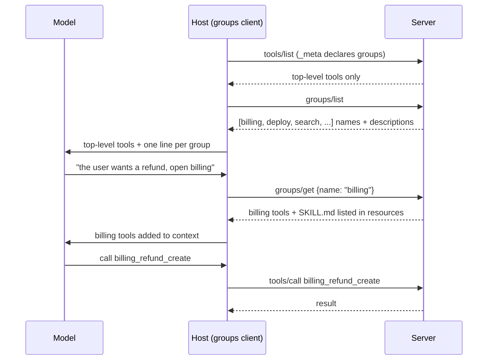
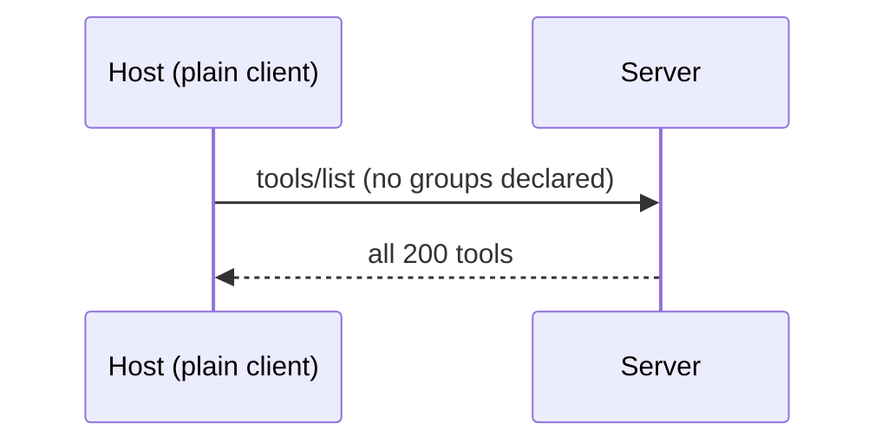
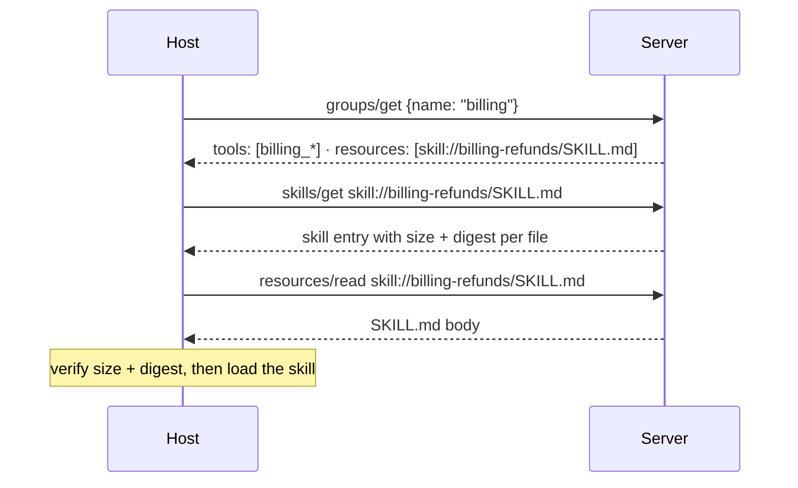
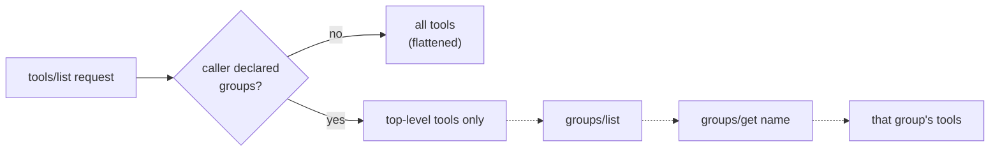
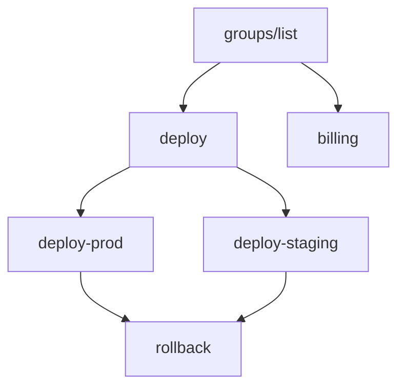

# Progressive disclosure

How a server with hundreds of tools shows a model only the ones it needs. The groups extension is a working-group draft, and mcpkit serves it from `experimental/ext/groups`. This page explains the draft as we read it, how it fits with skills, and what you can run today.

> **Kind:** root *(FAQ-style)* · **Prerequisites:** [bring-up](./bringup.md), [extension-mechanisms](./extension-mechanisms.md)
> **Reachable from:** [README](./README.md), [extension-mechanisms](./extension-mechanisms.md)
> **Branches into:** none yet
> **Spec:** [groups draft][spec-base] (progressive-disclosure-wg PR 19, pinned at `15b2a5cf`, 2026-11-07) · [SEP-2640 skills](https://github.com/modelcontextprotocol/modelcontextprotocol/pull/2640) · **Code:** [`experimental/ext/groups/`](https://github.com/panyam/mcpkit/tree/main/experimental/ext/groups) · [`server/list_scope.go`](https://github.com/panyam/mcpkit/blob/main/server/list_scope.go) · [`examples/disclosure/`](https://github.com/panyam/mcpkit/tree/main/examples/disclosure) · [`ext/skills/`](https://github.com/panyam/mcpkit/tree/main/ext/skills)

> [!CAUTION]
> **Experimental.** The groups extension is an Extensions Track draft with no sponsor. Method names, params and result shapes can change, and `experimental/ext/groups` will change with them. Everything below describes the draft at the pinned commit.

## Prerequisites

- You know how a session starts and how capabilities are negotiated. → If not, read [bring-up](./bringup.md).
- You know the four extension knobs (method namespace, capability flags, notifications, `_meta`). → If not, read [extension mechanisms](./extension-mechanisms.md).
- You know `ttlMs` and `cacheScope` on list results. → If not, read the [list-ttl example](https://github.com/panyam/mcpkit/tree/main/examples/list-ttl).

## Q1. What problem does progressive disclosure solve?

An agent connects to a server with 200 tools, calls `tools/list`, and gets 200 schemas back. The host puts every schema into the model's context before the user has asked anything. The user wants a refund, which takes two billing tools.

[`examples/disclosure`](https://github.com/panyam/mcpkit/tree/main/examples/disclosure) serves a server like that, with 200 tools in eight themes. Its flat `tools/list` is about 82 KB of JSON, and the host sends all of it to the model on every call. The draft also argues that a model picks the wrong tool more often as the list grows.

Skills already solve about half of this. A [skill](https://github.com/modelcontextprotocol/modelcontextprotocol/pull/2640) is a `SKILL.md` with instructions, and a host reads its body only when the model picks it. A skill can only *name* tools, though. A resource can't carry a tool's schema or make it callable. The tools still arrive through `tools/list`, all 200 of them.

Groups disclose the tools. The server shows one short entry per group. The model picks a group, and only then does the client fetch that group's tools.

## Q2. How does the groups extension use the extension knobs?

| Knob | What groups adds |
|---|---|
| **Method namespace** | `groups/list` and `groups/get` |
| **Capability flag** | The server declares `io.modelcontextprotocol/groups` under `capabilities.extensions`. The client declares it under `_meta["io.modelcontextprotocol/clientCapabilities"].extensions`. |
| **Notifications** | None. Clients re-fetch when `ttlMs` runs out. |
| **`_meta`** | The client puts its declaration in `_meta` on each request, so the server needs no session state to read it. |

The client declares the extension on each request because the server decides per request what that caller sees. On the stateless wire there's no session to remember it in, and on the session wire mcpkit reads both places through `core.ClientSupportsExtension`.

> [!IMPORTANT]
> Both sides opt in. A client must not send `groups/*` to a server that didn't advertise the extension. A server must not reject a client for lacking it.

## Q3. What does a groups session look like on the wire?

A `Group` has a `name`, an optional `title` and a `description`. The description tells the model *when* to pick the group. `groups/list` returns only those fields, never the tools inside.

`groups/get` takes `{"name": "billing"}` and returns the group's contents in one flat result:

- `instructions`: optional markdown on *how* to use the group
- `tools`, `prompts` and `resources`: complete definitions, ready to call
- `groups`: child groups, each fetched with its own `groups/get`

An unknown name returns `-32002`, the same code `resources/read` uses for an unknown URI.



A client without the extension sees none of this. It calls `tools/list` and gets the flat list:



The draft calls the moment a group comes into play *activation*, and it happens on the client. `groups/get` only fetches and changes nothing on the server. The host decides when to show a group's tools to the model, and it can drop them again without telling the server.

## Q4. Where do skills fit?

A group and a skill compose by reference. The group lists the skill's `SKILL.md` URI in its `resources`, next to the tools the skill's steps call.



A group doesn't change how a skill loads. The host still verifies and loads it through the skills extension, as it would for any other reference. Listing a skill in a group grants no approval. The group's own `instructions` are not a skill either, and they carry no digests.

The two extensions carry different things. Skills carry content, meaning instructions, reference files and assets. Groups carry typed, callable primitives, plus a pointer to the skill that drives them.

> [!NOTE]
> The working group has not settled how the two relate long term. The [positioning doc](https://github.com/modelcontextprotocol/progressive-disclosure-wg/pull/22) compares groups complementing skills, competing with them, and a rename to "Skills v2". The draft follows the complementary option.

## Q5. What must a server do for each caller?

The server builds a **client view** for each caller, from that caller's declared extensions. Four rules hold within a view.

1. **One placement per primitive.** A tool is either top-level, in `tools/list`, or scoped, in one or more groups. Never both. A scoped tool may sit in several groups, and its definition must be identical in each.
2. **Flatten for plain clients.** A client that didn't declare groups gets every tool the server wants it to use in `tools/list`. The server may hide a tool instead, but hiding is a discovery choice.
3. **Key every cache on capabilities.** `tools/list` now depends on the caller. A cached list built for a groups client must never reach a plain client. `groups/get` results are usually `cacheScope: "private"`.
4. **Discovery gating is not access control.** A scoped tool is a real tool. `tools/call` on it works whether or not the client fetched its group. Protect it with ordinary authorization.



In mcpkit, `server.SetListScope` installs the per-caller filter. `groups.Catalog.RegisterWith` installs one that hides grouped tools, prompts and resources from callers that declared the extension. The filter runs before paging, so every page a caller gets is full. With a filter installed, the base lists carry `cacheScope: "private"`, because a shared cache would hand one caller's list to another.

## Q6. How do nested groups work?

A group may list child groups in its `groups` field. A server uses this to keep `groups/list` short. For example, `deploy` might hold `deploy-staging` and `deploy-prod`.

- A child sits under one or more parents, and never in `groups/list` as well.
- Groups form a graph, so a child can have several parents, and cycles are allowed.
- A parent's `groups/get` doesn't expand its children, so each child takes its own `groups/get`.
- A client stops at any group it has already fetched, so a cycle ends without special detection.



The draft asks servers to keep the graph shallow, because each level adds one round trip.

## Q7. What can I run in mcpkit today?

| Piece | State |
|---|---|
| Skills (`ext/skills`) | Implemented. SEP-2640 Final. 45 server checks and 4 client scenarios pass. |
| Groups (`experimental/ext/groups`) | `groups/list`, `groups/get`, nested groups, `-32002` for unknown names, and a client with `List`, `Get` and a cycle-safe `Walk`. |
| Per-caller list filter | `server.SetListScope`, applied to `tools/list`, `prompts/list` and `resources/list` on both wires. |
| Fixture | [`examples/disclosure`](https://github.com/panyam/mcpkit/tree/main/examples/disclosure): 200 tools in eight groups, two skills, a `--check` mode. |
| Exercise | `make exercise-disclosure` at the repo root |

We wrote the fixture and its checks before any groups code, so the exercise failed first and then passed. It runs the skills suites, then connects two clients to the fixture on each wire. The plain client must get the flat list and a verified skill. The groups client must get groups instead:

```
  PASS stateless plain client: tools/list returns every tool: 200 of 200 tools, 82055 bytes
  PASS stateless plain client: SKILL.md reads and verifies: skill://billing-refunds/SKILL.md, 424 bytes, digest verified true
  PASS stateless groups client: groups/list returns one group per theme: 8 groups, want 8, 1030 bytes
  PASS stateless groups client: groups/get billing returns its tools and SKILL.md: 25 tools, want 25, SKILL.md listed true
  PASS stateless groups client: tools/list leaves out grouped tools: 0 of 200 tools, 156 bytes
  INFO stateless sizes: groups/get billing vs flat tools/list: groups/list 1030 + groups/get billing 10702 + tools/list 156 = 11888 bytes, flat tools/list 82055 bytes (14%)
```

The last row adds up what the groups client reads to reach the billing tools: `groups/list`, one `groups/get` and its empty `tools/list`. That's about 12 KB against 82 KB for the flat list.

> [!NOTE]
> The WG's TypeScript prototype ([PR 20](https://github.com/modelcontextprotocol/progressive-disclosure-wg/pull/20), at `9554415c`) agrees with mcpkit on negotiation, `groups/list` and `-32002`. It still nests `groups/get` contents under a `contents` key, which the draft dropped on 2026-11-07. It also returns the same `tools/list` to every caller.

## End-state

- You can say how much a flat `tools/list` puts into the model's context, and what skills leave unsolved.
- You know the two group methods, what each returns, and that `groups/get` changes no server state.
- You know a group lists a skill by URI, and the host still verifies the skill through the skills extension.
- You know the four per-caller rules: one placement, flatten for plain clients, caches keyed on capabilities, and scoping that is not access control.
- You know nested groups form a graph, and how a client stops on cycles.
- You know where mcpkit serves groups and the list filter, and how to run the exercise.

## Next to read

- **[Extension mechanisms](./extension-mechanisms.md)** *(root)*: how an extension moves from `experimental/ext/` to `ext/`, the path groups will take.
- **[List TTL](./list-ttl.md)** *(stub, leaf)*: the caching hints groups reuse in place of change notifications.
- **[`examples/disclosure`](https://github.com/panyam/mcpkit/tree/main/examples/disclosure)**: the fixture and its walkthrough.

[spec-base]: https://github.com/modelcontextprotocol/progressive-disclosure-wg/blob/15b2a5cf919702ae95a591856525486c857b3ea5/seps/0000-progressive-disclosure-groups.md
